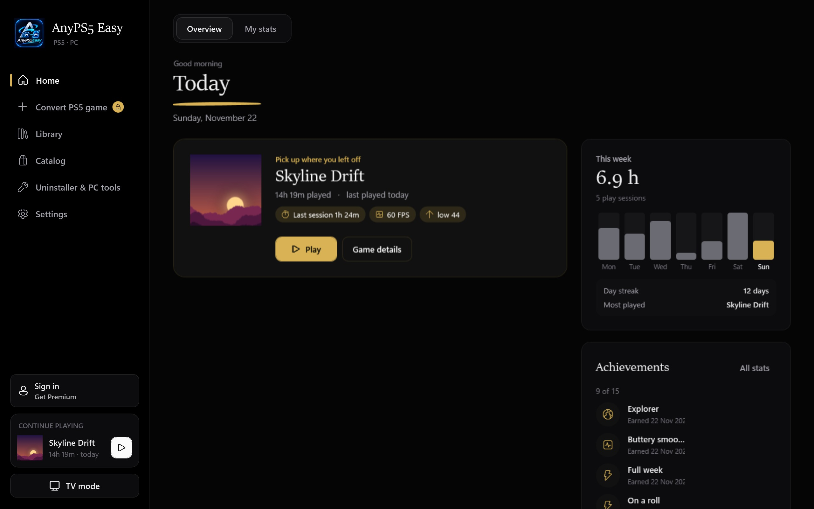
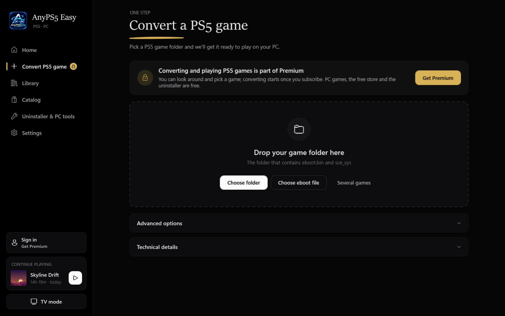
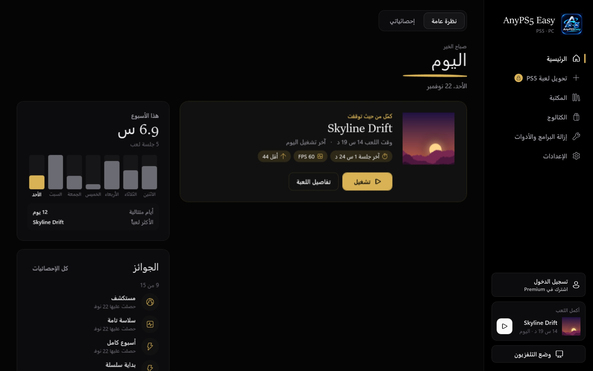

# AnyPS5 Easy

**Play PS5 games on your Windows PC in one click — in Arabic and English.**
**شغّل ألعاب PS5 على الكمبيوتر بضغطة واحدة — بالعربي والإنجليزي.**

---

## ✨ What is AnyPS5 Easy?

AnyPS5 Easy is a friendly Windows app built around the open-source **AnyPS5** engine. No commands, no setup headaches: pick your game, press one button, and play — with your controller, in full screen, in your language.

## 🎮 Features

- **One-click converting** — pick your PS5 game folder; the app prepares everything to run on your PC.
- **One library for everything** — your converted PS5 games plus your Steam and Epic PC games in one place.
- **Store** — free games and tools that download and land in your library automatically, with search and filters.
- **Performance mode** — smarter settings per game for smoother play, plus ANR frame generation for supported PC games.
- **Controllers** — PS5 DualSense, PS4 DualShock and Xbox controllers, including a full-screen **TV mode**.
- **Crash Doctor** — explains why a game closed and how to fix it; the game's log is saved automatically.
- **PC check** — checks your graphics card, driver, RAM and free space before converting (skippable).
- **Uninstaller & PC tools** — removes any Windows program down to its roots (files, registry, shortcuts, services) with a backup, plus PC cleanup, startup apps, “What's eating my disk?” and network tweaks for games.
- **Low-end PC boost** — checks your PC and turns on what really helps, each change reversible.
- **“Will it run on your PC?”** — real FPS numbers from players with the same graphics card.
- **Stats & achievements** — playtime, FPS and badges.
- **Arabic & English**, light & dark themes, and updates that install themselves (only when you're away).

## 💎 Free vs Premium

| Free | Premium |
|---|---|
| PC game library (Steam & Epic) | Convert PS5 games |
| Free store downloads | Play PS5 games |
| Uninstaller, stats, TV mode, controllers | Performance mode & ANR frame generation |
| — | Instant store downloads, no ads |

Plans start at **$4.99/month** — see [pricing](https://anyps5easy.site/pricing).

## 📥 Download & install

1. Download the latest version from **[anyps5easy.site/download/app](https://anyps5easy.site/download/app)** (a small setup that always gets the newest build and checks it), or the full app from **[Releases](../../releases/latest)**.
2. Run it. If Windows SmartScreen appears, click **More info → Run anyway** (the app isn't code-signed yet).
3. Follow the short setup — done.

**Requirements:** Windows 10/11 (64-bit) · a CPU with AVX2 · 16 GB RAM recommended · a dedicated graphics card with 6 GB+ VRAM and an up-to-date driver.

## 🛟 Support

- Discord: https://discord.gg/kKzcjCwths
- Email: cloud88560@gmail.com
- Help center & FAQ: https://anyps5easy.site/faq

---

## 🇪🇬 بالعربي

**AnyPS5 Easy** برنامج ويندوز سهل مبني على محرك **AnyPS5** مفتوح المصدر. من غير أوامر ولا تعقيد: اختار لعبتك، دوس زرار واحد، والعب بالدراع على الشاشة كلها.

**أهم المميزات:**
- تحويل ألعاب PS5 بضغطة واحدة.
- مكتبة واحدة لألعاب PS5 وألعاب الكمبيوتر (Steam و Epic).
- متجر ألعاب وأدوات مجاني، مع بحث وفلاتر.
- وضع الأداء وتوليد الإطارات ANR.
- دعم دراعات PS5 و PS4 و Xbox، ووضع التلفزيون.
- «دكتور الكراش» اللي بيقولك اللعبة قفلت ليه وإزاي تصلحها.
- فحص الجهاز قبل التحويل.
- إزالة البرامج من جذورها، وأدوات الجهاز (تنظيف، برامج بتفتح مع الويندوز، «مين واكل الهارد؟»).
- «وضع الأجهزة الضعيفة» و«هتشتغل على جهازك؟» بأرقام حقيقية من اللاعبين.
- عربي وإنجليزي، وثيم فاتح وغامق، والتحديثات بتتثبّت لوحدها.

**التحميل:** [AnyPS5Easy.exe](https://anyps5easy.site/download/app) — ولو ظهر تحذير الويندوز الأزرق دوس «More info» وبعدين «Run anyway».

**الدعم:** [Discord](https://discord.gg/kKzcjCwths) · cloud88560@gmail.com · [الأسئلة الشائعة](https://anyps5easy.site/faq?lang=ar)

---

## ⚖️ Legal

AnyPS5 Easy does not include or distribute any games, Sony firmware or copyrighted files. Use it only with games you legally own.
PlayStation and PS5 are trademarks of Sony Interactive Entertainment. AnyPS5 Easy is an independent project and is not affiliated with or endorsed by Sony.
Powered by the open-source [AnyPS5](https://github.com/boykopovar/AnyPS5) engine. ANR frame generation by [apex-compute/ANR](https://github.com/apex-compute/ANR).

[Terms](https://anyps5easy.site/terms) · [Privacy](https://anyps5easy.site/privacy) · [Refunds](https://anyps5easy.site/refunds) · [Disclaimer](https://anyps5easy.site/disclaimer)
